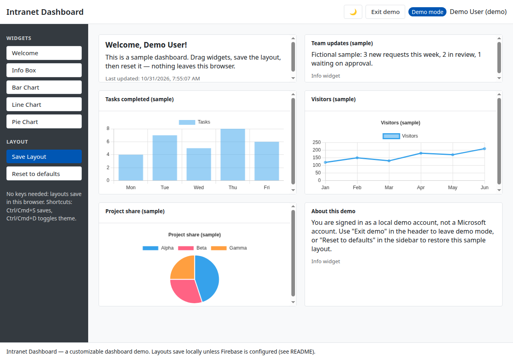
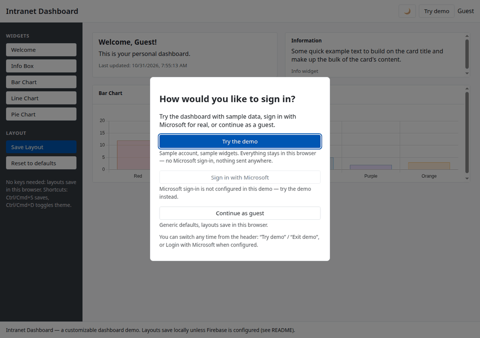
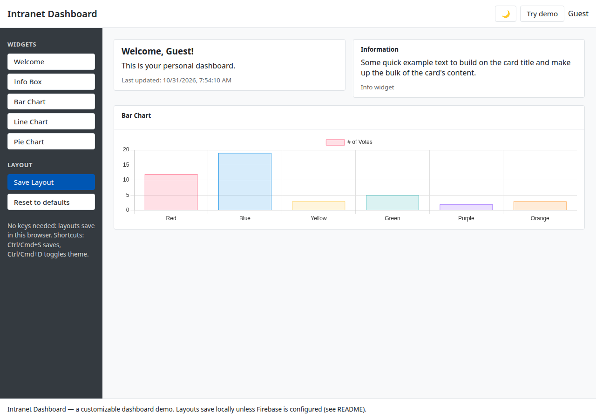
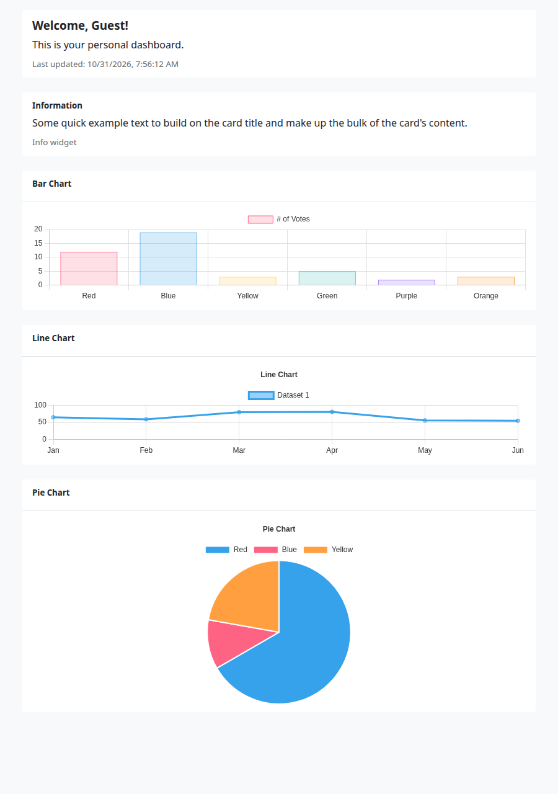
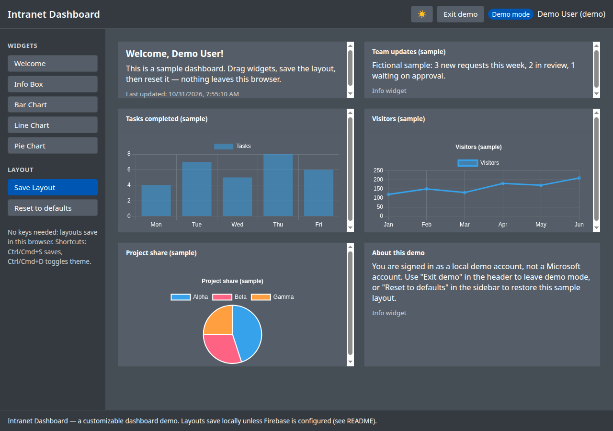
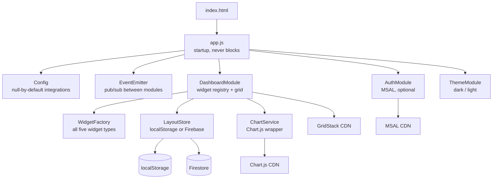
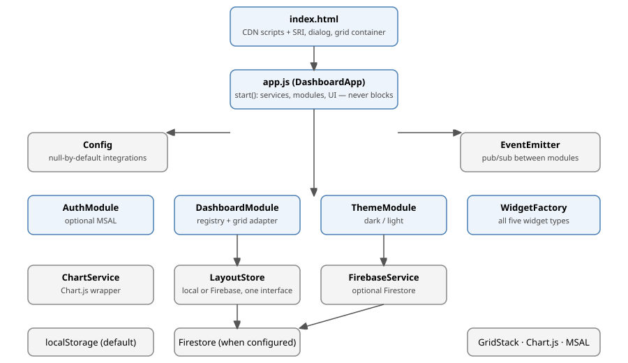

# Intranet Dashboard

A customizable, user-personalized dashboard web app. Add widgets, drag them
around, save the layout, switch themes — and run the whole demo with no
account, no keys, and no backend.






## Description

Intranet Dashboard is a single-page dashboard built in vanilla JavaScript
(no framework, no build step). Visitors can add widgets to a drag-and-drop
GridStack grid, rearrange them, save the layout, and switch between dark
and light themes. Layouts save in the visitor's browser by default, so the
demo works with nothing configured at all.

Two optional integrations can be injected at runtime, both off by default:

- **Microsoft sign-in (MSAL)** — visitors sign in with a Microsoft account
  and get a per-account layout. No Microsoft 365 data is fetched.
- **Firebase / Firestore persistence** — layouts move from localStorage to
  Firestore, guarded by per-user rules in `firestore.rules`.

If either integration is unavailable (offline, blocked CDN, unconfigured),
the app degrades instead of failing: a plain flex layout replaces GridStack
if GridStack fails to load, and local storage replaces Firebase if Firebase
is unreachable. Startup never blocks on an external service.

## Prerequisites

- A modern browser with ES-module and `<dialog>` support (any current
  Chrome, Edge, Firefox, or Safari).
- For local development and tests: **Node.js 20 or later** (the test suite
  uses `node:test`; there are no npm dependencies to install).
- For the built-in dev server: **Python 3** (used by `npm start`), or any
  static file server of your choice.
- For deployment: a GitHub account and a **public** repository (GitHub
  Pages on a free plan does not serve private repositories).

You do **not** need a Microsoft Azure tenant, a Firebase project, or any
API keys to run the demo. Those are only needed if you want the optional
integrations in [Configuration](#configuration-optional).

## Installation

```bash
git clone https://github.com/enonymous1/intranet-dashboard.git
cd intranet-dashboard
```

There is nothing to install: the project has no runtime npm dependencies
and no build step. The only third-party code is loaded at runtime from
CDNs (GridStack, Chart.js, and MSAL/Firebase only when configured), each
pinned by version and, for classic scripts, by SRI hash.

Verify your checkout:

```bash
npm test        # node:test suite (29 tests, plus the browser smoke test below)
npm run check   # node --check on every module
```

## Local Development

Serve `dashboard-app/` over HTTP — opening `index.html` directly via
`file://` breaks ES-module loading in most browsers:

```bash
npm start
# Serves dashboard-app/ at http://localhost:8000
```

Or, from the repo root, any static server works:

```bash
cd dashboard-app
python3 -m http.server 8000
# Open http://localhost:8000
```

What to try first:

1. Open the page. On first visit a dialog offers three paths — **Try the
   demo**, **Sign in with Microsoft**, or **Continue as guest**.
2. Click **Try the demo**. You get a local, fictional demo account
   ("Demo User", `demo@example.com`) and a sample dashboard with fictional
   figures. Nothing is a Microsoft account, no redirect happens, no token
   is issued, and nothing leaves the browser.
3. Drag a widget, click **Save Layout**, reload — the layout round-trips
   with titles, info text, and chart settings intact (the original saved
   only type and geometry).
4. Toggle the theme (header button, or Ctrl/Cmd+D). Theme changes recreate
   charts only; they do not reload the dashboard.
5. Click **Reset to defaults** to restore the sample layout in demo mode,
   or the generic defaults as a guest. Ctrl/Cmd+S saves.

Running tests:

```bash
npm test                          # whole suite (29 tests)
node --test tests/layout.test.js  # a single file
npm run smoke                     # browser smoke test: GridStack layout + fallback layout
                                  # in a real headless Chromium (needs CHROME_BIN
                                  # or Chrome on PATH; see scripts/browser-smoke.mjs)
npm run check                     # node --check on every module (glob, not a list)
npm run sri:check                 # verify CDN SRI hashes match the pinned versions
```

### Troubleshooting

| Symptom | Cause | Fix |
|---|---|---|
| Blank page / module errors when opening the file directly | `file://` blocks ES modules | Serve over HTTP (see above) |
| Widgets stacked at the top-left, overlapping | GridStack failed to load (offline, blocked CDN) and the fallback is in use — or, on v1.1.0, the GridStack init bug fixed in v1.1.1 | Check the network tab for the GridStack request; the fallback layout is intentional when GridStack is unavailable, but on a normal connection you should see the full grid |
| Sign-in dialog keeps appearing | Choice is stored in localStorage; private mode may not persist it | Not a bug — the dialog is first-visit only when storage persists |
| Port 8000 already in use | Another server on that port | `python3 -m http.server 8001 --directory dashboard-app` |

## Features

- **Drag-and-drop dashboard** powered by GridStack, with a plain-layout
  fallback if GridStack fails to load (offline, blocked CDN) — widgets
  still render, add, remove, and save.

  

- **Five widget types:** Welcome, Info Box, Bar Chart, Line Chart, Pie
  Chart.

  

- **Layouts that actually round-trip.** A saved layout stores each
  widget's id, type, geometry, *and* options (titles, info text, chart
  settings).
- **Saving that works with no account.** Layouts save to localStorage by
  default, keyed by Microsoft account when signed in, otherwise by a
  stable per-browser guest id. Each account gets its own layout.
- **Dark/light theme** that persists in localStorage, follows the OS by
  default, and syncs across tabs.

  

- **Demo mode, chosen by the visitor** (see below), and **optional
  Microsoft sign-in and Firebase persistence**, both injected at runtime
  and both off by default.

## Demo mode

On first visit, before anything else happens, a dialog asks how the
visitor wants to sign in:

- **Try the demo** — signs in as a local, fictional demo account ("Demo
  User", `demo@example.com`) and loads a sample dashboard: welcome card,
  team updates, tasks-per-day bar chart, visitors line chart, and
  project-share pie chart, all with fictional figures. Nothing is a
  Microsoft account, no redirect happens, no token is issued, and nothing
  leaves the browser. Demo layouts save under the `demo` identity in
  localStorage (`intranet-dashboard:layout:demo`), so a saved demo layout
  is still there on the next demo visit.
- **Sign in with Microsoft** — only attempted when the visitor clicks it,
  and disabled entirely in the dialog when MSAL is not configured (with a
  note saying so), so a visitor is never sent into a broken login flow.
- **Continue as guest** — generic defaults, layouts save under a
  per-browser guest id.

The choice is remembered in localStorage (`intranet-dashboard:mode`), so
the dialog appears once. Switching any time: the header has a **Try demo /
Exit demo** button, and Login with Microsoft when configured. In demo
mode a "Demo mode" badge shows in the header, the name reads "Demo User
(demo)", and **Reset to defaults** in the sidebar restores the sample
layout instead of the generic defaults.

## Configuration (optional)

Add a script **before** `js/app.js` in `dashboard-app/index.html`:

```html
<script>
  window.INTRANET_FIREBASE_CONFIG = {
    apiKey: '…', authDomain: '….firebaseapp.com',
    projectId: '…', appId: '1:…:web:…'
  };
  window.INTRANET_MSAL_CONFIG = {
    clientId: '…', authority: 'https://login.microsoftonline.com/…'
  };
  window.INTRANET_APP_ID = 'my-app';
</script>
```

Notes on the two integrations:

- **Firebase:** layouts move to Firestore at
  `artifacts/<appId>/users/<uid>/dashboard/layout`, keyed by the Firebase
  Auth UID (anonymous by default, or a custom token via
  `window.INTRANET_AUTH_TOKEN`). Apply `firestore.rules` at the repo root
  first — it restricts each document to its own UID. Without those rules,
  a published Firebase config lets anyone read or overwrite any user's
  layout. If Firebase is unreachable, the app falls back to local storage
  after an 8-second cap instead of failing.
- **MSAL:** only the login/logout buttons use it; no Microsoft 365 data
  is fetched. MSAL stays on the 2.14 line on purpose — moving to v3 needs
  a live Azure app registration to verify against.
- **Security:** no credentials are hardcoded anywhere in this repo.
  Widget titles, info text, and notification messages are HTML-escaped,
  and icon class names are allow-listed, so a saved layout cannot inject
  markup. CDN scripts that load as classic scripts (GridStack, Chart.js,
  MSAL when used) carry SRI hashes.

## Architecture





Startup order, and why it never blocks: the app probes Firebase with an
8-second cap (on failure, local storage wins), initializes auth
non-fatally (no config means guest mode), then loads the dashboard
layout, and only then shows the first-visit sign-in dialog if no choice
is remembered. No step waits on a network service before the page renders.

## Project layout

```
dashboard-app/
  index.html
  css/custom.css
  js/
    app.js                    # startup: services, then modules, then UI (never blocks on Firebase/MSAL)
    config/config.js          # null-by-default Firebase/MSAL config, defaults, GridStack options
  config/versions.js        # pinned CDN versions (SRI manifest source of truth)
    core/
      constants.js            # storage keys + event names (single definition)
      event-emitter.js        # pub/sub between modules
      escape.js               # HTML escaping + icon sanitizing
      layout.js               # widget identity, validation, versioned serialization (tested)
      theme-tokens.js         # single chart colour palette (ThemeModule + ChartService)
      widgets.js              # widget registry (sidebar, validation, chart dispatch)
    modules/
      auth-module.js          # optional MSAL, awaited init, session via getAllAccounts()
      dashboard-module.js     # widget registry, save/load (delegates layout to grid-adapter)
      grid-adapter.js         # GridStack adapter + flex fallback adapter (one contract)
      theme-module.js         # dark/light, localStorage, OS preference, cross-tab sync
      widget-factory.js       # widget HTML, all five types, escaped fields
    services/
      chart-service.js        # Chart.js 4 wrapper, theme-aware colors, missing-Chart guard
      firebase-service.js     # optional Firestore load/save, explicit init
      layout-store.js         # localStorage store + Firebase store behind one interface
firestore.rules               # per-user layout rules (see above)
tests/                        # node:test: config, demo, escape, event-emitter,
                              #   gridstack-init, layout, layout-store, widget-factory
scripts/                      # browser-smoke.mjs, capture-screenshots.mjs,
                              #   check.mjs, update-sri.mjs (dev tooling only)
docs/
  screenshots/                # demo-light.png, demo-dark.png, demo-tour.gif,
                              #   widgets.png, fallback.png
  diagrams/                   # architecture.svg
```

## Deployment

### GitHub Pages (recommended)

1. Push to `main`. The `pages.yml` workflow runs the syntax check and
   tests first, then publishes `dashboard-app/` via the official Pages
   actions.
2. **One-time setup:** repo Settings → Pages → Build and deployment →
   Source → **GitHub Actions**. This creates the Pages site. Until you do
   this, the first Pages run fails with "Get Pages site failed / Not
   Found" — that is a missing site, not a workflow bug, and adding
   `enablement: true` to the workflow does not fix it under the default
   `GITHUB_TOKEN`.
3. Re-run the failed workflow (Actions → failed run → Re-run jobs). No
   new push is needed.
4. The site is served at `https://<owner>.github.io/intranet-dashboard/`.

The published demo runs locally in the visitor's browser with no keys —
Firebase and MSAL stay off unless you inject a config into your own
hosting copy. The repository must be public for Pages on a free GitHub
plan.

### Any static host

Copy `dashboard-app/` to any static host (Netlify, Vercel, S3, nginx).
There is no build step and no server-side code. If you want Firebase or
MSAL on that host, inject the config script from
[Configuration](#configuration-optional) into your hosted copy of
`index.html` — do not commit real keys to the repo.

## Verification status

Verified as of v1.2.0 (2026-10-31):

- `node:test` suite: 29/29 passing; `node --check` on every module; local
  HTTP smoke test (index, CSS, JS all 200).
- Browser smoke test (`npm run smoke`) in a real headless Chromium:
  GridStack grid (`gs-12`) with the guest layout at (0,0,6,2), (6,0,6,2),
  (0,2,12,4), a registry-generated sidebar with five buttons, and a
  fallback-layout run (GridStack blocked) rendering 50% / 50% / 100%.
  The Pages workflow runs this smoke test before publishing, so a
  broken layout cannot be deployed again.
- Demo, dark-theme, fallback, and first-visit dialog screenshots in
  `docs/screenshots/` were captured from the v1.2.0 code in a real
  headless browser (see `scripts/capture-screenshots.mjs` to regenerate
  them after a visual change).

Not yet verified live:

- First CI run after push, and the Pages deploy itself on a fresh repo.
- A real MSAL sign-in against a live Azure app registration (needs a
  tenant this project does not ship).

## Contributing

Issues and pull requests are welcome. A few maintainer expectations, so
your PR does not bounce:

- Run `npm test` and `npm run check` before opening a PR.
- A layout fix needs a browser-level assertion (see the review's §1),
  not only a `node:test` case — unit tests do not cover GridStack.
- Do not commit real Firebase/MSAL credentials, and do not add a widget
  type by editing five files — see the widget-registry proposal in the
  review before extending the widget set.
- Keep the demo self-contained: no keys, no backend, no network calls
  beyond the pinned CDNs.

## License

MIT. See [LICENSE](LICENSE).
